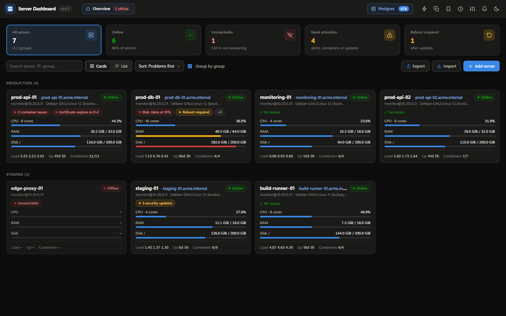
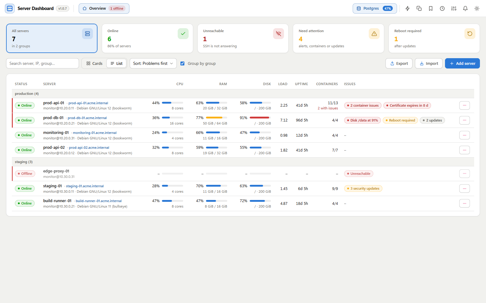
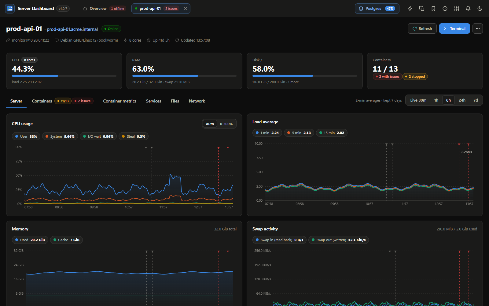
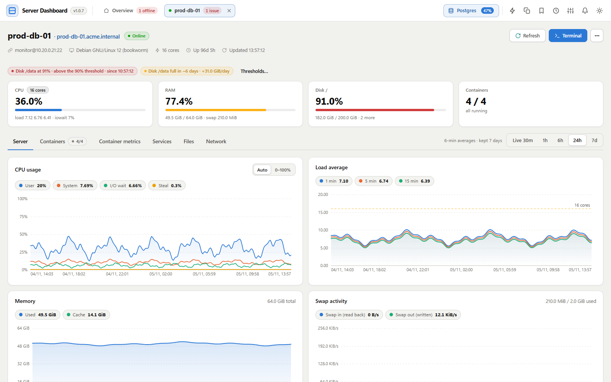
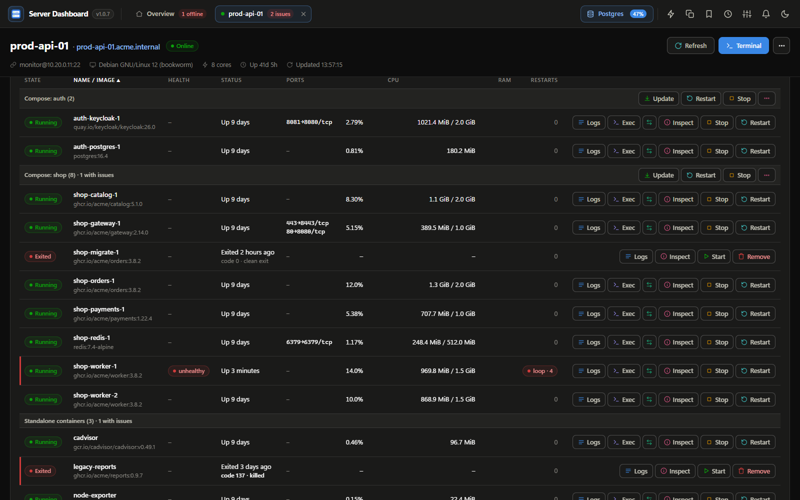
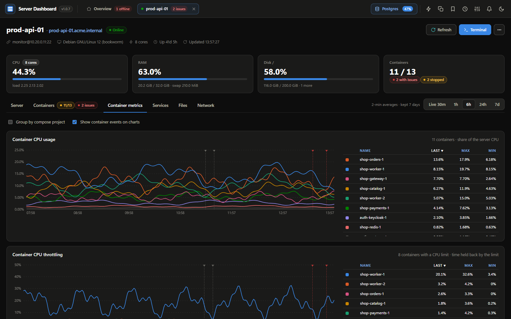
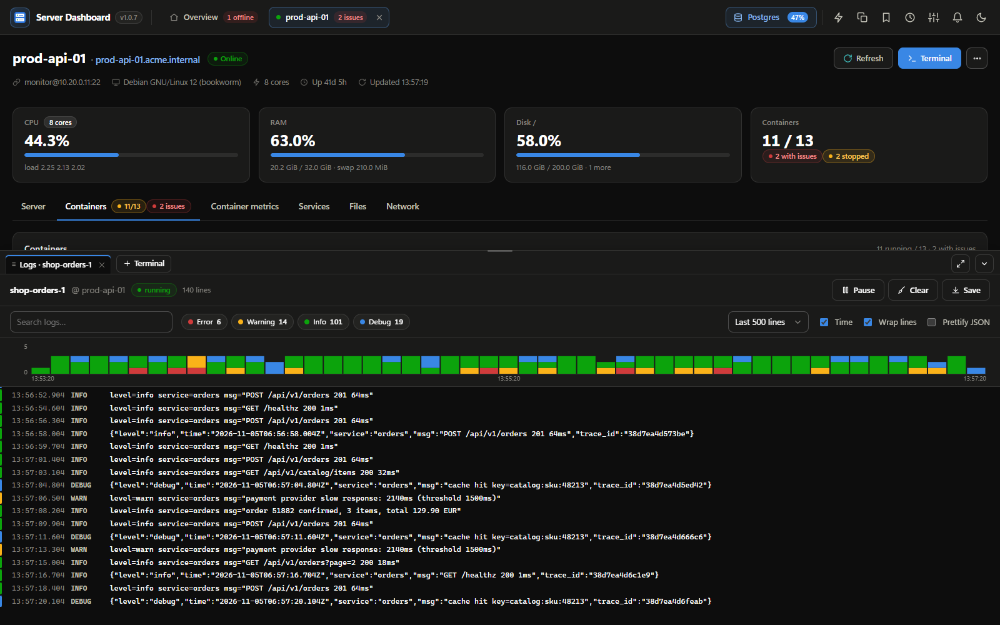
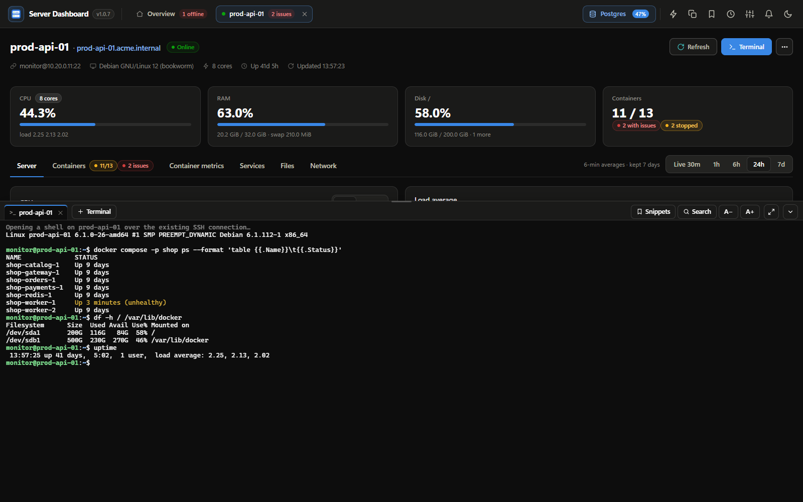
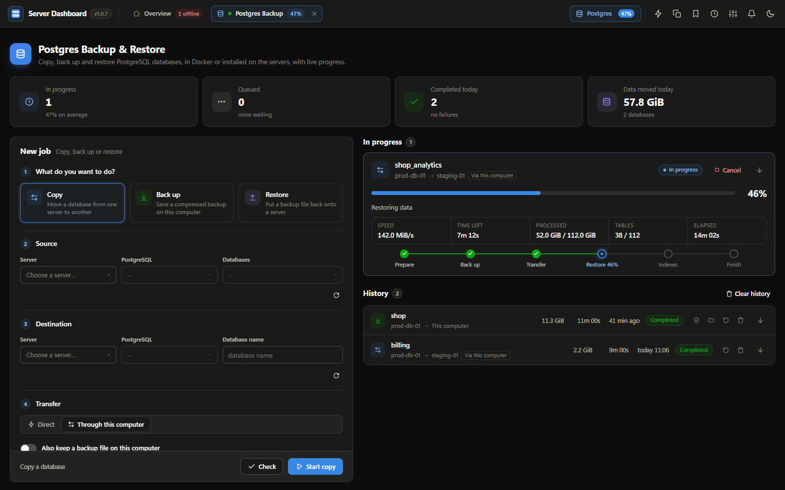
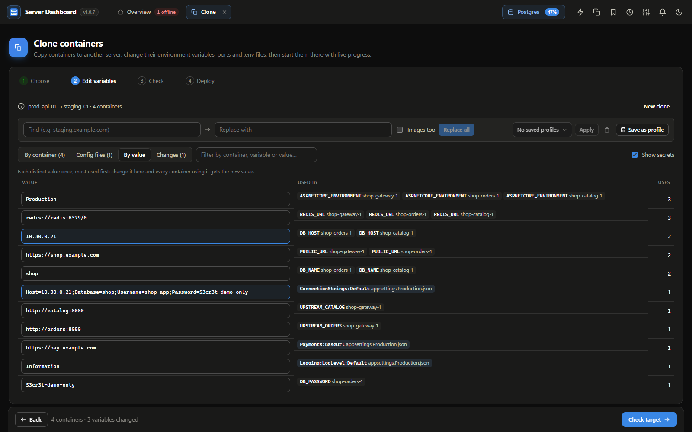

# Server Dashboard

**A desktop app for monitoring and operating Debian + Docker servers over SSH. You don't install any agent on the servers.**

Add your servers once to see CPU, memory, disks and containers on all of them, with live charts and 7 days of history.
You can follow logs, open a terminal, restart containers, back up Postgres databases and clone containers to another server
without leaving the app. It runs on Windows, macOS and Linux and keeps itself up to date.



<p align="center">
  <a href="../../releases/latest"><b>Download the latest release</b></a> ·
  <a href="#features">Features</a> ·
  <a href="#getting-started">Getting started</a> ·
  <a href="#security">Security</a> ·
  <a href="desktop/README.md">Full documentation</a>
</p>

> All screenshots use made-up demo data.

## Download

| Platform | File | Notes |
|---|---|---|
| **Windows 10 / 11** | `ServerDashboard-windows-amd64-setup.exe` | Installs for your account (no admin rights), with Start menu and desktop shortcuts. A portable `.exe` is also available. |
| **macOS** (Intel and Apple Silicon) | `ServerDashboard-macos-universal.dmg` | Open it and drag the app to Applications. The first time, right-click the app and choose *Open* (the build is not notarized). |
| **Debian / Ubuntu** | `ServerDashboard-linux-amd64.deb` | `sudo apt install ./ServerDashboard-linux-amd64.deb` |
| **Other Linux** | `ServerDashboard-linux-amd64.tar.gz` | Needs `libwebkit2gtk-4.1-0` and `libgtk-3-0`. |

Every release is built by GitHub Actions. The app checks for new versions in the background and verifies each update's
**Ed25519 signature** and SHA-256 checksum before installing it. You can turn this off in the Updates dialog.

## Features

### Every server at a glance

The **Overview** shows every server as a card or as a row in a sortable list. Each one has its status, CPU, RAM,
fullest disk, load, uptime, containers and anything that needs attention: unreachable servers, threshold alerts,
unhealthy or restarting containers, certificates about to expire, pending security updates and required reboots.
Sort by *Problems first* to see those servers at the top.



### Detailed server metrics with history

Each server opens in its own tab, like a browser. The charts show CPU split into user, system, I/O wait and steal, along with load,
memory and cache, swap activity, disk I/O and latency, pressure stall information (PSI), TCP connections and disk space.
Pick **Live 30m** for 5-second samples, or **1h, 6h, 24h or 7d** from the history stored on disk.



The app warns you before a disk fills up. It fits a straight-line trend to each mount over the last 3 days and
shows *Full in ~6 days · +31 GiB/day*. Alerts for CPU, memory, I/O wait, disk and inode usage use thresholds you can change.



### Containers

The containers table shows state, health, exit codes in plain words, ports, CPU (as a share of the whole server), memory
against its limit, and restart counts with restart-loop detection. Containers are grouped by Compose project.
Start, stop, restart, remove, inspect or open a shell in one with **Exec**. A Compose project can be updated
(`pull` + `up -d`), restarted or edited from its row.



### Grafana-style container metrics

Charts show CPU, CPU throttling, memory, memory against limit, network and disk I/O for every container. Each chart has a
sortable Last / Max / Min legend. Container events from `docker events` (restarts, exits, OOM kills, health changes) are drawn as markers on the charts.



### Logs and terminal

The log viewer draws a volume histogram by level. It detects the level of JSON, logfmt and plain-text lines, and has
filter chips, search, a *Prettify JSON* option and a save-to-file button. It reconnects by itself after a container restarts. The built-in terminal (xterm.js) opens a shell
on the server or inside a container over the SSH connection the app already holds, so you don't log in again.





### Postgres Backup & Restore

This tab **copies** a database to another server, **backs it up** to a file on your computer or **restores** a backup.
Jobs run inside the database containers, so the tools always match the server version. They use parallel `pg_dump` / `pg_restore`
and zstd compression, and show live progress for every step and table. Backup files carry SHA-256 checksums and can be
encrypted with [age](https://age-encryption.org). Roles, owners and database settings can be copied too.
A database is restored under a temporary name and renamed only once it is complete, so a failed job never leaves a
broken database behind.



### Clone containers to another server

This tab copies containers started with `docker run` to another server in four steps: **Choose → Edit variables → Check → Deploy**.
You can edit variables per container or **by value** (each distinct value once: change it there and it changes in every container that uses it),
or use find and replace across all containers and mounted `.env` / `appsettings.json` files.
The target is checked for name clashes, ports already in use, missing paths and CPU architecture before anything is started.
Images can be pulled or copied straight from the source server.



### More tools

- **Services tab** (systemd): start, stop, restart, enable or disable services and follow their journal.
- **Files tab** (SFTP): browse, edit, upload and download files, and save root-owned files through `sudo -n`.
- **Network tab**: listening ports with their process and container, and **port forwarding** (`ssh -L`) in one click.
- **Maintenance**: shows pending and security updates, required reboots and TLS certificate expiry. Run `apt upgrade` or reboot from the app.
- **Docker cleanup**: removes stopped containers, unused images, build cache, networks and volumes, showing the space you get back.
- **Run on servers**: runs one command on many servers at once and shows the results side by side.
- **Snippets**, an **Activity** log of everything done from the app, **jump hosts** (`ssh -J`), desktop notifications,
  light and dark themes, and import and export of the server list.

## Getting started

### 1. Prepare each server

Create a dedicated user that signs in with an SSH key:

```bash
sudo adduser --disabled-password --gecos "" monitor
sudo usermod -aG docker monitor          # lets it run docker without sudo
sudo -u monitor mkdir -p ~monitor/.ssh
echo "ssh-ed25519 AAAA... dashboard" | sudo tee -a ~monitor/.ssh/authorized_keys
```

> ⚠️ Membership in the `docker` group is equivalent to root. If you don't want that, skip `usermod` and allow only the
> docker command in sudoers (`monitor ALL=(root) NOPASSWD: /usr/bin/docker`), then tick *Run docker with sudo -n*
> when adding the server.

Actions that need root (reboot, starting or stopping services, editing root-owned files) use `sudo -n`. They work when
the user is root or when sudo needs no password for that command.

### 2. Add the server in the app

Click **Add server** and enter the host, port and user. Then choose how to sign in: a private key (pasted or picked from a file),
the SSH agent, or a password. Click **Test connection**, then **Save**. To reach servers behind a bastion, choose it under *Connect through*.

## Security

- **No agent and no open ports on the servers.** Everything runs over SSH. The app keeps one connection per server and runs one
  read-only command every 5 seconds, or every 30 seconds while minimized.
- **Host keys are trusted on first use.** If a host key changes later, the app refuses to connect, which protects against man-in-the-middle attacks.
- **Secrets are encrypted at rest.** Passwords and private keys are encrypted with Windows DPAPI, so only your Windows account can
  read them, and with AES-GCM on macOS and Linux. Exports never contain secrets.
- **Commands are built by the app from validated input.** Database logins and cloned container variables are passed
  through stdin or private files, never on a command line.
- **Updates are signed.** The app installs nothing unless it is signed with the project's release key.

Settings, the server list and metric history are stored in `%AppData%\ServerDashboard\` on Windows, in
`~/Library/Application Support/ServerDashboard/` on macOS and in `~/.config/ServerDashboard/` on Linux.

## Building from source

The app is written in Go with [Wails](https://wails.io). The UI is plain JavaScript and needs no build step.

```powershell
go install github.com/wailsapp/wails/v2/cmd/wails@v2.16.0   # once
cd desktop
./build.ps1                                                 # → build/bin/ServerDashboard.exe
```

Pushing a tag such as `v1.2.0` makes CI publish a release with the installers for every platform and a signed update manifest.
See [desktop/README.md](desktop/README.md) for the full feature reference, the release process, the signing-key setup and the code layout.

## Legacy web version

The repository root also contains the original browser-based version (Node.js, in `src/` and `public/`). It is no longer
developed and is kept for reference only. To run it:

```bash
cp .env.example .env      # then set ADMIN_PASSWORD
npm install
npm start                 # http://localhost:8080
```

You can also run it with Docker: `docker compose up -d --build`. Don't expose it to the Internet. Put it behind a VPN or an HTTPS reverse proxy.
